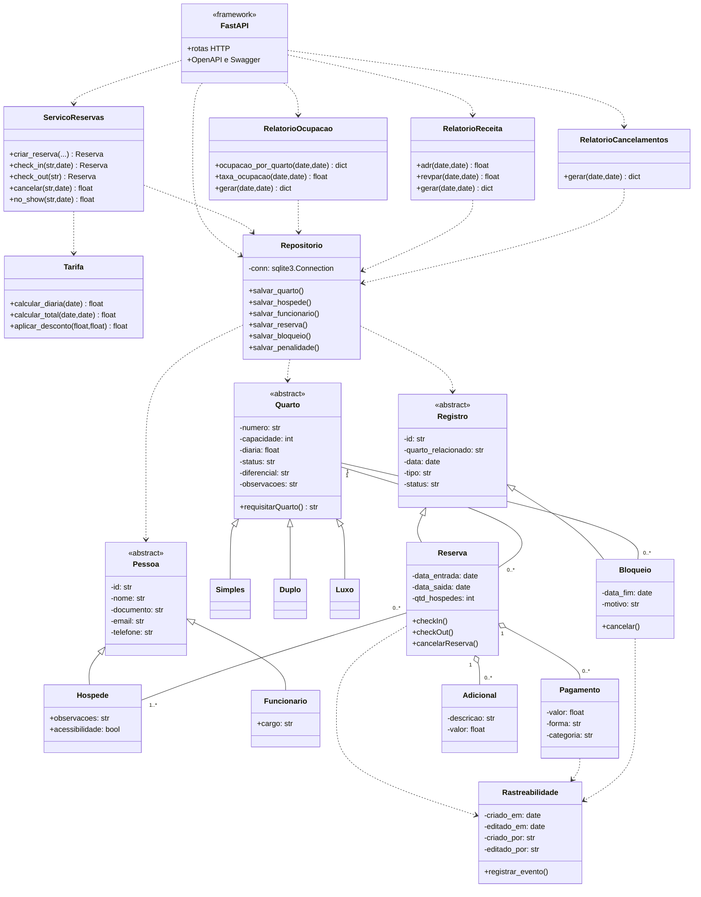

# SISTEMA DE RESERVAS DE HOTEL POR WELLINGTON D. ANGELO
Projeto individial da disciplina ES0008 - Programação Orientada a Objetos ministrada no semestre 2026.2

---
## Objetivo
O projeto consiste em desenvolver uma API de um sistema de reservas de hotel. Este permitirá acesso aos dados de hóspedes, quartos e reservas com check-in/check-out. Também devendo conter tratamentos para política de cancelamento, tarifas por temporada, bloqueios por manutenção e relatórios de desempenho.

Além disto, buscarei aprender a utilizar as ferramentas FastAPI e SQlite para o desenvolvimento deste projeto.

---

## Estrutura planejada de classes


```text
SRH-WDA/
├── app/
│   ├── main.py                 # criação da aplicação FastAPI (ASGI)
│   ├── api.py                  # APIRouter e endpoints HTTP
│   ├── database/
│   │   └── repositorio.py      # SQLite, migrações e persistência
│   ├── models/
│   │   ├── __init__.py
│   │   ├── pessoas.py          # Pessoa, Hospede e Funcionario
│   │   ├── quartos.py          # Quarto, Simples, Duplo e Luxo
│   │   ├── registros.py        # Registro, Reserva, Pagamento, Adicional e Bloqueio
│   │   └── rastreios.py        # Rastreabilidade e histórico
│   ├── schemas/
│   │   ├── __init__.py
│   │   └── api.py              # modelos Pydantic de entrada
│   └── services/
│       ├── __init__.py
│       ├── reservas.py         # regras e fluxos de reserva
│       ├── tarifas.py          # cálculo das diárias
│       └── relatorios.py       # ocupação, ADR, RevPAR e cancelamentos
├── tests/
│   ├── test_api.py
│   ├── test_funcionarios_bloqueios.py
│   ├── test_lancamentos.py
│   ├── test_pessoas.py
│   ├── test_quartos.py
│   ├── test_relatorios.py
│   ├── test_reservas.py
│   ├── test_servicos_reservas.py
│   └── test_tarifas.py
├── requirements.txt
├── requirements-dev.txt
├── README.md
└── srh_wda.db                 # criado automaticamente na primeira execução
```

## 3. Banco de dados

O `Repositorio` cria as tabelas ausentes e migra colunas de versões anteriores sem apagar os registros existentes.

| Tabela | Responsabilidade |
|---|---|
| `quartos` | Tipo, capacidade, diária, status e características do quarto. |
| `hospedes` | Cadastro de hóspedes. |
| `funcionarios` | Cadastro de funcionários e cargo. |
| `reservas` | Período, status e quarto reservado. |
| `reserva_hospedes` | Associação entre reservas e hóspedes. |
| `pagamentos` | Recebimentos, forma, data e categoria (`hospedagem`, `adicional` ou `outro`). |
| `adicionais` | Despesas adicionais lançadas na reserva. |
| `bloqueios` | Quarto, intervalo de manutenção, motivo e status. |
| `penalidades` | Multas de cancelamento e no-show, inclusive eventos com valor zero. |
| `rastreabilidade` | Metadados de criação e edição. |
| `historico_rastreabilidade` | Eventos de auditoria. |

### Indicadores financeiros

Os relatórios usam o intervalo semiaberto `[inicio, fim)`: a data inicial é incluída e a data final não é incluída.

- **ADR:** pagamentos recebidos da categoria `hospedagem` no período divididos pelas noites vendidas no período.
- **RevPAR:** pagamentos recebidos da categoria `hospedagem` no período divididos pelas noites disponíveis.
- Pagamentos classificados como `adicional` ou `outro` não entram na receita de hospedagem.
- A receita segue regime de caixa (data de recebimento). Não distribui contabilmente um pagamento entre as noites da estadia.
- **Ocupação:** reservas confirmadas, hospedadas ou finalizadas que se sobrepõem ao período, divididas pelas noites disponíveis.
- **Cancelamentos:** os totais e multas são filtrados pela data do evento. As taxas por coorte usam as reservas criadas no período.

Se não houver noites vendidas ou quartos disponíveis, ADR e RevPAR retornam zero para evitar divisão por zero.

## 4. Instalação e execução

Requisitos: Python 3.10 ou superior.

```bash
# Ambiente virtual (recomendado)
python -m venv .venv
source .venv/bin/activate

# Dependências da aplicação
python -m pip install -r requirements.txt

# Para executar também os testes
python -m pip install -r requirements-dev.txt

# Iniciar a API
uvicorn app.main:app --reload
```

A API ficará disponível em `http://127.0.0.1:8000`.

- Documentação interativa Swagger: `http://127.0.0.1:8000/docs`
- Documentação alternativa ReDoc: `http://127.0.0.1:8000/redoc`
- Esquema OpenAPI: `http://127.0.0.1:8000/openapi.json`
- Verificação de saúde: `http://127.0.0.1:8000/health`

Para usar outro banco SQLite:

```bash
HOTEL_DB=./dados/hotel.db uvicorn app.main:app --reload
```

O diretório `./dados` deve existir antes da inicialização. As migrações são executadas automaticamente pelo repositório.

## 5. Endpoints

| Método | Rota | Finalidade |
|---|---|---|
| `GET` | `/health` | Verifica a API. |
| `GET`, `POST` | `/quartos` | Lista e cadastra/atualiza quartos. |
| `GET`, `POST` | `/hospedes` | Lista e cadastra/atualiza hóspedes. |
| `GET`, `POST` | `/funcionarios` | Lista e cadastra funcionários. |
| `GET` | `/funcionarios/{id}` | Consulta funcionário. |
| `GET`, `POST` | `/bloqueios` | Lista e cadastra bloqueios por intervalo. |
| `POST` | `/bloqueios/{id}/cancelar` | Cancela um bloqueio. |
| `GET`, `POST` | `/reservas` | Lista e cria reservas. |
| `GET` | `/reservas/{id}` | Consulta reserva. |
| `POST` | `/reservas/{id}/checkin` | Realiza check-in. |
| `POST` | `/reservas/{id}/checkout` | Realiza check-out. |
| `POST` | `/reservas/{id}/cancelar` | Cancela e calcula multa. |
| `POST` | `/reservas/{id}/noshow` | Registra no-show e calcula multa. |
| `POST` | `/reservas/{id}/pagamentos` | Lança pagamento com categoria. |
| `POST` | `/reservas/{id}/adicionais` | Lança adicional. |
| `GET` | `/relatorios` | Retorna todos os relatórios consolidados. |
| `GET` | `/relatorios/ocupacao` | Relatório de ocupação. |
| `GET` | `/relatorios/adr` | ADR. |
| `GET` | `/relatorios/revpar` | RevPAR. |
| `GET` | `/relatorios/cancelamentos` | Cancelamentos, no-shows e multas. |

As rotas de relatório recebem `inicio` e `fim` como query parameters no formato `AAAA-MM-DD`.

## 6. Exemplos de uso

Cadastre quarto e hóspede:

```bash
curl -X POST http://127.0.0.1:8000/quartos \
  -H 'Content-Type: application/json' \
  -d '{"numero":"101","tipo":"Simples","capacidade":2,"diaria":100,"status":"disponivel"}'

curl -X POST http://127.0.0.1:8000/hospedes \
  -H 'Content-Type: application/json' \
  -d '{"id":"h1","nome":"Ana Souza","documento":"12345678901","email":"ana@example.com","telefone":"88999998888"}'
```

Crie uma reserva:

```bash
curl -X POST http://127.0.0.1:8000/reservas \
  -H 'Content-Type: application/json' \
  -d '{"id":"r1","quarto":"101","entrada":"2026-12-10","saida":"2026-12-12","hospedes_ids":["h1"],"qtd_hospedes":1}'
```

Realize check-in e check-out:

```bash
curl -X POST http://127.0.0.1:8000/reservas/r1/checkin \
  -H 'Content-Type: application/json' -d '{"hoje":"2026-12-10"}'

curl -X POST http://127.0.0.1:8000/reservas/r1/checkout
```

Registre um bloqueio de manutenção:

```bash
curl -X POST http://127.0.0.1:8000/bloqueios \
  -H 'Content-Type: application/json' \
  -d '{"id":"b1","quarto":"101","data_inicio":"2026-12-15","data_fim":"2026-12-18","motivo":"Manutenção elétrica"}'
```

Lance pagamento e consulte os relatórios:

```bash
curl -X POST http://127.0.0.1:8000/reservas/r1/pagamentos \
  -H 'Content-Type: application/json' \
  -d '{"id":"p1","forma":"pix","valor":300,"data":"2026-12-12","categoria":"hospedagem"}'

curl 'http://127.0.0.1:8000/relatorios?inicio=2026-12-01&fim=2027-01-01'
```

A API usa códigos HTTP convencionais: `201` para criação, `404` para recurso inexistente, `409` para conflito de integridade no SQLite e `422` para dados inválidos ou regras de negócio não atendidas.

## 7. Testes

Na raiz do projeto:

```bash
python -m pytest -q
```

Os testes da API usam `fastapi.testclient.TestClient` e SQLite em memória, sem iniciar um servidor externo. Os testes de serviços e repositório verificam regras de negócio e persistência separadamente.

## 8. UML final



### Componentes da API

- `app/main.py`: instancia o FastAPI, configura ciclo de vida e tratamento de erros.
- `app/api.py`: declara um único `APIRouter` e as rotas HTTP.
- `app/schemas/api.py`: valida os corpos das requisições com Pydantic.
- `app/services/`: mantém as regras de negócio fora dos endpoints.
- `app/database/repositorio.py`: centraliza o SQLite e as migrações.