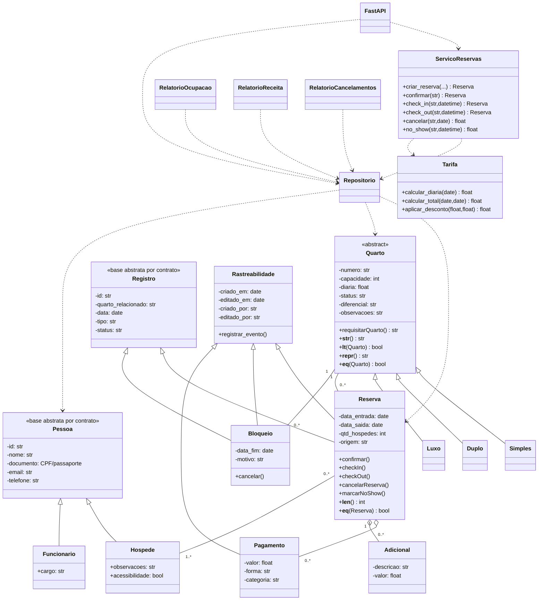
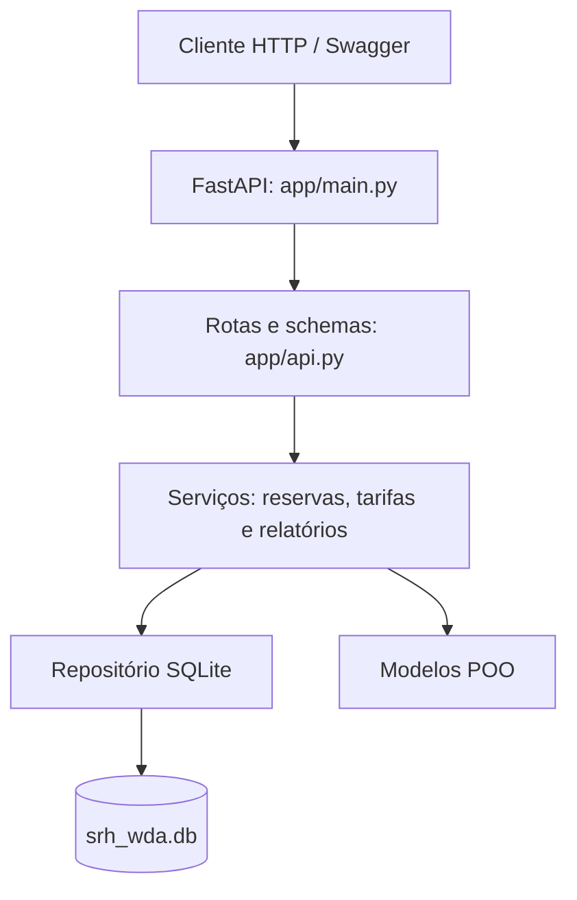

# SISTEMA DE RESERVAS DE HOTEL POR WELLINGTON D. ANGELO
Projeto individial da disciplina ES0008 - Programação Orientada a Objetos ministrada no semestre 2026.2

---
## Objetivo
O projeto consiste em desenvolver uma API de um sistema de reservas de hotel. Este permitirá acesso aos dados de hóspedes, quartos e reservas com check-in/check-out. Também devendo conter tratamentos para política de cancelamento, tarifas por temporada, bloqueios por manutenção e relatórios de desempenho.

Além disto, buscarei aprender a utilizar as ferramentas FastAPI e SQlite para o desenvolvimento deste projeto.

---

## Estrutura planejada de classes

```text
SRH-WDA/
├── app/
│   ├── main.py                 # criação da aplicação FastAPI/ASGI
│   ├── api.py                  # rotas HTTP (APIRouter)
│   ├── config.py               # leitura e validação de settings.json
│   ├── database/
│   │   ├── repositorio.py      # SQLite, migrações e consultas
│   │   └── seed.py             # carga inicial idempotente de 7 quartos
│   ├── models/
│   │   ├── pessoas.py          # Pessoa, Hospede e Funcionario
│   │   ├── quartos.py          # Quarto, Simples, Duplo e Luxo
│   │   ├── registros.py        # Registro, Reserva, Pagamento, Adicional e Bloqueio
│   │   └── rastreios.py        # metadados e histórico de auditoria
│   ├── schemas/
│   │   └── api.py              # schemas Pydantic
│   └── services/
│       ├── reservas.py         # regras de reserva e estadia
│       ├── tarifas.py          # cálculo de diárias
│       └── relatorios.py       # indicadores e consolidações
├── tests/                      # testes unitários e de integração
├── settings.json               # horários, tolerâncias, multas e temporadas
├── requirements.txt            # dependências de execução
├── requirements-dev.txt        # dependências de desenvolvimento/testes
├── README.md
└── srh_wda.db                  # banco SQLite local (criado se ausente)
```

### Responsabilidades

- **`main.py`:** cria a aplicação FastAPI, inicializa o repositório e converte erros de domínio/integridade em respostas HTTP.
- **`api.py`:** declara as rotas, valida recursos existentes e chama serviços/repositório.
- **`schemas/api.py`:** valida os dados de entrada e impede campos extras.
- **`services/`:** concentra cálculos e transições de estado; não depende de HTTP.
- **`database/repositorio.py`:** implementa SQL, migrações e conversão entre linhas e objetos.
- **`models/`:** representa as entidades e suas validações encapsuladas.

## 4. Configurações

As regras ajustáveis ficam em `settings.json`:

| Configuração | Valor inicial |
|---|---:|
| Check-in | 14:00 |
| Antecipação permitida para check-in | 30 minutos |
| Check-out | 12:00 |
| Tolerância para atraso no check-out | 0 minuto |
| Tolerância de no-show após 23:59 | 60 minutos |
| Cancelamento gratuito | 48 horas antes da entrada |
| Multa de cancelamento fora do prazo | 100% de uma diária de entrada |
| Multiplicador de fim de semana | 1,30 |

O arquivo também contém três intervalos de temporada, com início, fim e multiplicador próprios. Os períodos de temporada são inclusivos. As noites de sexta-feira e sábado recebem o multiplicador de fim de semana. Quando ambos os critérios se aplicam, os multiplicadores são acumulados.

Para alterar regras, edite `settings.json` e reinicie a aplicação. `app/config.py` carrega e valida o arquivo; se ele não existir, usa configurações padrão seguras.

## 5. Regras de negócio

### Reservas e estados

1. A criação pela API registra a reserva como **Pendente**.
2. `POST /reservas/{id}/confirmar` confirma a reserva após revalidar quarto, bloqueios e conflitos.
3. Check-in só ocorre em reserva Confirmada, na data prevista e a partir do horário configurado (considerando tolerância).
4. Check-out só ocorre em reserva Hospedado e quando o total pago cobre hospedagem, adicionais e diárias extras por atraso.
5. Reservas Pendentes ou Confirmadas podem ser canceladas. Reservas Pendentes não geram multa.
6. No-show só pode ser registrado depois das 23:59 da data de entrada mais a tolerância configurada.

Reservas usam intervalo semiaberto `[entrada, saída)`: a data de saída não é uma noite ocupada. Bloqueios de manutenção usam início e fim inclusivos. Canceladas e No-show não ocupam o quarto.

### Disponibilidade e manutenção

Não são permitidas reservas Confirmadas/Hospedado sobrepostas para o mesmo quarto. A confirmação revalida a disponibilidade para evitar que duas reservas Pendentes sejam confirmadas em conflito. Bloqueios ativos impedem reservas e check-in em qualquer data que intercepte seu intervalo. O cancelamento do bloqueio libera o período.

### Pagamentos e adicionais

Formas de pagamento aceitas: dinheiro, cartão de crédito, cartão de débito e PIX (também são aceitos os aliases `credito`, `debito`, `cartao_credito` e `cartao_debito`). Cada pagamento possui uma categoria: `hospedagem`, `adicional` ou `outro`. Adicionais são vinculados à reserva e entram no total devido do check-out.

### Relatórios

Todos os relatórios usam o intervalo semiaberto `[inicio, fim)`, incluindo a data inicial e excluindo a data final.

- **Ocupação (%):** noites ocupadas / noites disponíveis × 100. Noites com manutenção/bloqueio ativo não entram no denominador.
- **ADR:** recebimentos de hospedagem no período / noites vendidas no período.
- **RevPAR:** recebimentos de hospedagem no período / noites de quartos disponíveis no período.
- **Cancelamentos/no-shows:** eventos e multas são filtrados pela data do evento; o relatório também informa taxas por coorte de reservas criadas no período.
- **Receita por tipo:** soma recebimentos de hospedagem por categoria do quarto associado à reserva.

**Critério financeiro:** ADR e RevPAR seguem regime de caixa, usando a data do recebimento. O sistema não distribui um pagamento antecipado entre as noites da estadia. Por isso, em períodos com pagamentos parciais ou antecipados, os indicadores refletem recebimentos do período, não competência contábil.

## 6. Instalação e execução

Requisitos: Python 3.10 ou superior.

```bash
# Na raiz do projeto
python -m venv .venv
source .venv/bin/activate       # Linux/macOS
# No Windows PowerShell: .venv\Scripts\Activate.ps1

python -m pip install --upgrade pip
python -m pip install -r requirements.txt
python -m pip install -r requirements-dev.txt

uvicorn app.main:app --reload
```

A API ficará em `http://127.0.0.1:8000`.

- Swagger UI: `http://127.0.0.1:8000/docs`
- ReDoc: `http://127.0.0.1:8000/redoc`
- OpenAPI: `http://127.0.0.1:8000/openapi.json`
- Health check: `http://127.0.0.1:8000/health`
- Configurações ativas: `http://127.0.0.1:8000/configuracoes`

Para selecionar outro arquivo SQLite, defina `HOTEL_DB` antes de iniciar:

```bash
HOTEL_DB=./dados/hotel.db uvicorn app.main:app --reload
```

O diretório informado deve existir. As tabelas/colunas ausentes são criadas por migração automática, sem apagar registros antigos.

### Carga inicial (seed)

O seed insere sete quartos (três Simples, três Duplos e um Luxo) e pode ser executado mais de uma vez sem duplicar quartos:

```bash
python -m app.database.seed
```

As três temporadas são configuradas em `settings.json`, não gravadas como dados de quarto no SQLite.

## 7. Endpoints da API

| Método | Rota | Operação |
|---|---|---|
| GET | `/health` | Verifica a API |
| GET | `/configuracoes` | Consulta regras ativas |
| GET, POST | `/quartos` | Lista e cadastra quartos |
| GET, PUT, DELETE | `/quartos/{numero}` | Consulta, atualiza e remove quarto |
| GET, POST | `/hospedes` | Lista e cadastra hóspedes |
| GET, PUT, DELETE | `/hospedes/{id}` | Consulta, atualiza e remove hóspede |
| GET | `/hospedes/{id}/reservas` | Histórico do hóspede |
| GET, POST | `/funcionarios` | Lista e cadastra funcionários |
| GET | `/funcionarios/{id}` | Consulta funcionário |
| GET, POST | `/bloqueios` | Lista e cria bloqueio de manutenção |
| POST | `/bloqueios/{id}/cancelar` | Cancela/desbloqueia período |
| GET, POST | `/reservas` | Lista e cria reserva Pendente |
| GET | `/reservas/{id}` | Consulta reserva e totais |
| GET | `/reservas/{id}/valor` | Simula valor da hospedagem e saldo |
| POST | `/reservas/{id}/confirmar` | Confirma reserva Pendente |
| POST | `/reservas/{id}/checkin` | Realiza check-in |
| POST | `/reservas/{id}/checkout` | Realiza check-out após validação financeira |
| POST | `/reservas/{id}/cancelar` | Cancela e calcula multa |
| POST | `/reservas/{id}/noshow` | Registra no-show e multa |
| POST | `/reservas/{id}/pagamentos` | Lança pagamento |
| POST | `/reservas/{id}/adicionais` | Lança adicional |
| GET | `/relatorios` | Relatórios consolidados |
| GET | `/relatorios/ocupacao` | Ocupação por período |
| GET | `/relatorios/adr` | ADR |
| GET | `/relatorios/revpar` | RevPAR |
| GET | `/relatorios/cancelamentos` | Cancelamentos, no-shows e multas |
| GET | `/relatorios/receita-por-tipo` | Receita por categoria de quarto |

Os endpoints de relatório recebem `inicio` e `fim` no formato `AAAA-MM-DD`.

## 8. Exemplos de uso

Os exemplos abaixo assumem a API iniciada localmente.

### Cadastrar quarto e hóspede

```bash
curl -X POST http://127.0.0.1:8000/quartos \
  -H 'Content-Type: application/json' \
  -d '{"numero":"101","tipo":"Simples","capacidade":2,"diaria":100,"status":"disponivel"}'

curl -X POST http://127.0.0.1:8000/hospedes \
  -H 'Content-Type: application/json' \
  -d '{"id":"h1","nome":"Ana Souza","documento":"12345678901","email":"ana@example.com","telefone":"88999998888"}'
```

### Criar e confirmar reserva

```bash
curl -X POST http://127.0.0.1:8000/reservas \
  -H 'Content-Type: application/json' \
  -d '{"id":"r1","quarto":"101","entrada":"2026-12-10","saida":"2026-12-12","hospedes_ids":["h1"],"qtd_hospedes":1,"origem":"site"}'

curl -X POST http://127.0.0.1:8000/reservas/r1/confirmar
```

### Check-in, pagamento e check-out

O pagamento deve cobrir o valor calculado da hospedagem e os adicionais antes de finalizar a saída.

```bash
curl -X POST http://127.0.0.1:8000/reservas/r1/checkin \
  -H 'Content-Type: application/json' \
  -d '{"momento":"2026-12-10T14:00:00"}'

# Exemplo: o valor deve corresponder ao cálculo tarifário da estadia.
curl -X POST http://127.0.0.1:8000/reservas/r1/pagamentos \
  -H 'Content-Type: application/json' \
  -d '{"id":"p1","forma":"pix","valor":345,"data":"2026-12-12","categoria":"hospedagem"}'

curl -X POST http://127.0.0.1:8000/reservas/r1/checkout \
  -H 'Content-Type: application/json' \
  -d '{"momento":"2026-12-12T12:00:00"}'
```

### Bloqueio de manutenção

```bash
curl -X POST http://127.0.0.1:8000/bloqueios \
  -H 'Content-Type: application/json' \
  -d '{"id":"b1","quarto":"101","data_inicio":"2026-12-15","data_fim":"2026-12-18","motivo":"Manutenção elétrica"}'

curl -X POST http://127.0.0.1:8000/bloqueios/b1/cancelar
```

### Relatórios

```bash
curl 'http://127.0.0.1:8000/relatorios?inicio=2026-12-01&fim=2027-01-01'
curl 'http://127.0.0.1:8000/relatorios/receita-por-tipo?inicio=2026-12-01&fim=2027-01-01'
```

## 9. Testes

Execute na raiz do projeto:

```bash
python -m pytest -q
python -m compileall -q app tests
```

Os testes da API usam `fastapi.testclient.TestClient` com SQLite em memória. Os testes unitários verificam entidades, validações, tarifas, regras de reserva, persistência, relatórios, seed e migrações. Na revisão final desta versão, `python -m pytest -q` executou **149 testes aprovados**.

## 10. Decisões de projeto

- **FastAPI + Pydantic:** validação dos contratos HTTP e documentação OpenAPI automática.
- **SQLite:** persistência simples e transacional adequada ao escopo acadêmico.
- **Repository:** SQL isolado dos modelos, serviços e endpoints.
- **Services:** regras de negócio centralizadas e reutilizáveis fora da API.
- **Composição:** `Reserva` mantém listas de `Pagamento` e `Adicional`; a relação com hóspedes é persistida em tabela associativa.
- **Herança múltipla:** `Reserva` e `Bloqueio` herdam de `Registro` e `Rastreabilidade`.
- **Migrações:** colunas novas são adicionadas sem recriar ou apagar o banco existente.
- **Configuração externa:** horários, tolerâncias, multas e temporadas não ficam hardcoded no serviço tarifário.

## 11. UML final



### Fluxo da API


